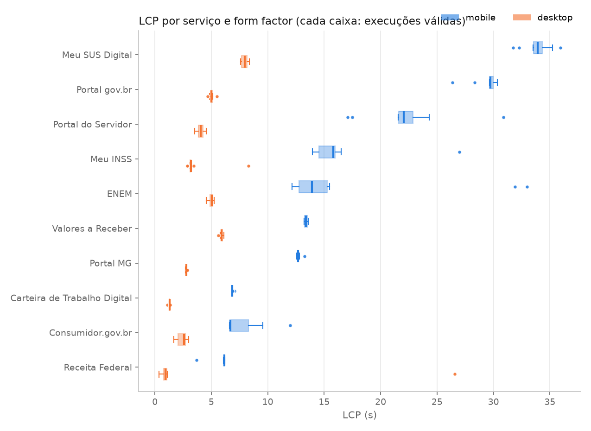
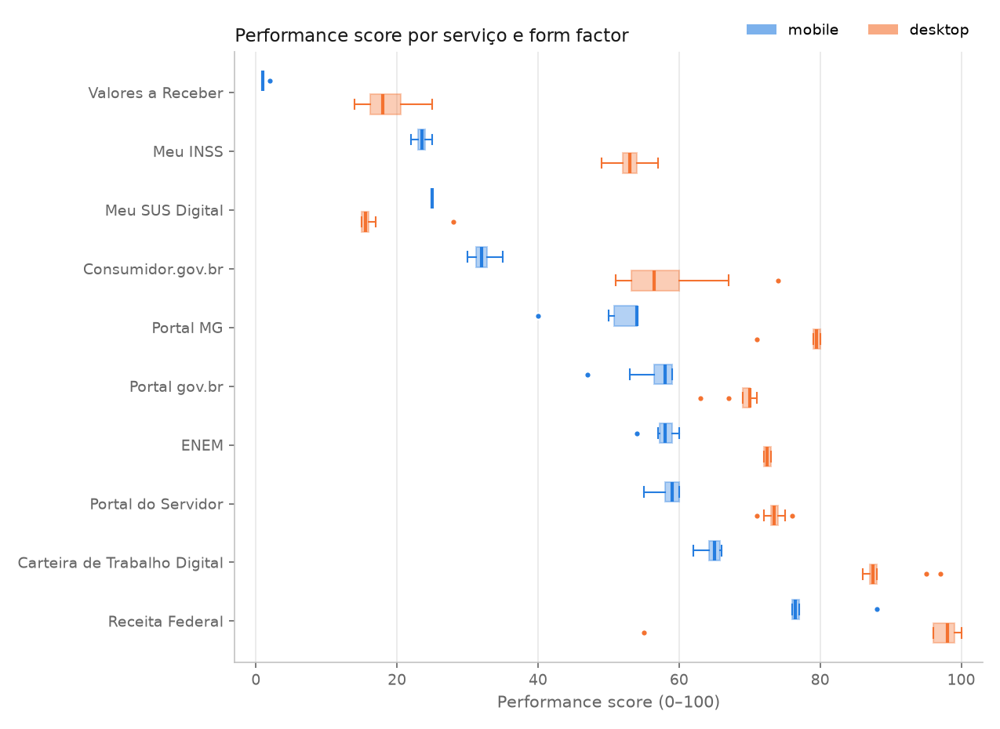
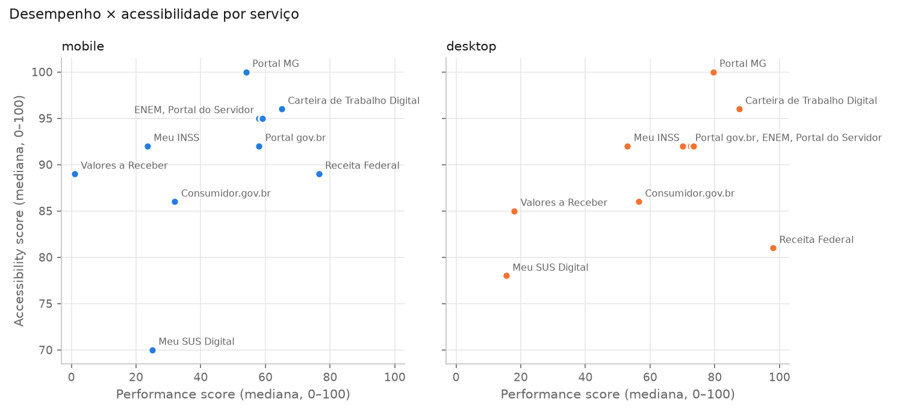
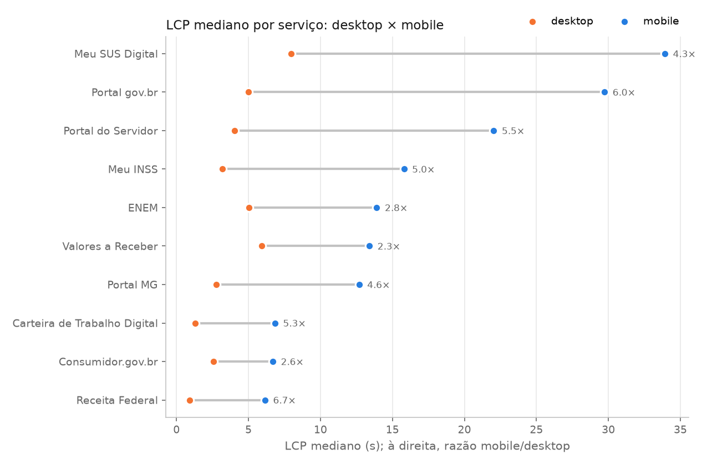

# Resultados — coleta completa (Sprint 2)

Dados: fase `full`, 25/11/2026, 10 serviços × 2 form factors × 10 execuções = **200 execuções válidas** (validação em [`docs/data-validation.md`](../docs/data-validation.md): 0 erros, 0 avisos). Tabelas completas em `analysis/output/todas/` (todas as execuções) e `analysis/output/sem-outliers/` (sem os valores marcados pela regra de Tukey). Para refazer tudo:

```
.venv/Scripts/python analysis/run_all.py
```

Esse comando roda a extração, a validação, a análise e os gráficos, com seed fixa de bootstrap (20261125, 10 000 reamostragens). Versões em `analysis/output/analysis-metadata.json`.

Os tempos estão em segundos. LCP, FCP, Speed Index e TBT saem do throttling simulado do Lighthouse (modelo Lantern): são estimativas de laboratório, não tempos medidos num celular real (ver [`docs/ameacas-validade.md`](../docs/ameacas-validade.md)).

## 1. Dados usados

| Item | Valor |
|---|---|
| Sessões | `morning` 11:38–12:14 e `afternoon` 15:01–15:39 (horário de Brasília), 25/11/2026 |
| Tentativas | 205: 200 válidas e 5 inválidas, todas do Consumidor.gov.br (`NO_FCP`: a página não pintou nada, e as métricas vieram nulas). Cada uma foi registrada em `data/failed-runs.csv` e refeita. |
| Execuções excluídas da análise | 0 (nenhuma com `SLOW_HOST_CPU`). Duas têm `BENCHMARK_LOW_OUTLIER` (Consumidor.gov.br mobile #5 e Carteira de Trabalho Digital mobile #3) e ficaram, porque a marcação é só para revisão. |
| Outliers (Tukey, 1,5 × IQR por serviço × form factor × métrica) | 105 valores em 60 execuções. Ficam nos dados; a variante `sem-outliers` tira só o valor marcado, na métrica em que ele foi marcado. |
| Blocos | Cada execução leva o rótulo da sessão em que rodou. O Consumidor.gov.br tem 6 execuções à tarde e 4 de manhã, porque as duas execuções #2 inválidas da manhã foram refeitas à tarde. |

Outliers por métrica:

| Métrica | Valores fora da cerca | Células serviço × form factor afetadas |
|---|---|---|
| CLS | 21 | 13 |
| FCP | 16 | 9 |
| LCP | 29 | 15 |
| SpeedIndex | 13 | 8 |
| TBT | 9 | 7 |
| accessibilityScore | 1 | 1 |
| performanceScore | 16 | 12 |

Com 10 execuções quase idênticas, o IQR de uma célula às vezes fica em poucos milissegundos, e a cerca de Tukey marca valores que estão a 1–2% da mediana. Por isso a contagem é alta, mas a maior parte dos valores marcados não muda nada na prática.

## 2. Escala das métricas e estatísticas permitidas

| Métrica | Escala | O que se usa |
|---|---|---|
| Performance score (0–100) | Numericamente de razão, mas **tratado como ordinal**: é uma média ponderada de notas que passam por curvas log-normal, limitada a 0–100. A mesma diferença de 10 pontos não representa a mesma diferença de tempo em pontos diferentes da escala. | Mediana, quartis, IQR e testes de postos. Média e DP aparecem na descritiva só porque a entrega pede. |
| Accessibility score (0–100) | **Tratado como ordinal**: proporção ponderada de regras automáticas do axe-core aprovadas. | Mediana e postos. Quase não varia dentro de um serviço (18 de 20 grupos são constantes). |
| LCP, FCP, Speed Index, TBT (ms; aqui em s, exceto TBT) | Razão (zero absoluto). | Tudo é permitido, inclusive razões ("mobile 4,8× mais lento"). Como as distribuições são assimétricas e há outliers, o centro é a mediana. |
| CLS (adimensional) | Razão. | Só descritiva. |

## 3. Normalidade

Shapiro–Wilk por serviço × form factor (20 grupos por métrica, n = 10 cada). Grupos com valor constante não são testados.

| Métrica | Grupos | Testados | Normalidade rejeitada (p < 0,05) | Constantes (sem teste) |
|---|---|---|---|---|
| performanceScore | 20 | 19 | 11 | 1 |
| accessibilityScore | 20 | 2 | 2 | 18 |
| LCP | 20 | 20 | 10 | 0 |
| FCP | 20 | 20 | 8 | 0 |
| TBT | 20 | 16 | 7 | 4 |
| CLS | 20 | 19 | 16 | 1 |
| SpeedIndex | 20 | 20 | 10 | 0 |

A normalidade é rejeitada em cerca de metade dos grupos de LCP e de performance score, e em quase todos os de CLS. Com n = 10, o Shapiro–Wilk tem pouco poder, e não rejeitar a normalidade não prova que ela existe. Os testes não paramétricos (Kruskal–Wallis, Dunn, Spearman, Wilcoxon) foram escolhidos antes da coleta por dois motivos: os scores são ordinais e os tempos são assimétricos. O Shapiro–Wilk só documenta essa escolha. Os valores por grupo estão em `descriptives.csv` (`shapiro_W`, `shapiro_p`).

## 4. Estatística descritiva

Todas as execuções (variante `todas`). Ordem: mobile e depois desktop, do pior para o melhor. As tabelas de FCP, Speed Index, TBT e CLS estão no [apêndice](#apêndice-a--descritiva-das-outras-métricas).

### 4.1 Performance score

| Serviço | Form factor | n | Mediana | Q1 – Q3 | IQR | Média | DP | Mín. | Máx. |
|---|---|---|---|---|---|---|---|---|---|
| Valores a Receber | mobile | 10 | 1,0 | 1,0 – 1,0 | 0,0 | 1,2 | 0,4 | 1,0 | 2,0 |
| Meu INSS | mobile | 10 | 23,5 | 23,0 – 24,0 | 1,0 | 23,5 | 1,1 | 22,0 | 25,0 |
| Meu SUS Digital | mobile | 10 | 25,0 | 25,0 – 25,0 | 0,0 | 25,0 | 0,0 | 25,0 | 25,0 |
| Consumidor.gov.br | mobile | 10 | 32,0 | 31,2 – 32,8 | 1,5 | 32,1 | 1,4 | 30,0 | 35,0 |
| Portal MG | mobile | 10 | 54,0 | 50,8 – 54,0 | 3,2 | 51,7 | 4,4 | 40,0 | 54,0 |
| ENEM | mobile | 10 | 58,0 | 57,2 – 59,0 | 1,8 | 57,9 | 1,7 | 54,0 | 60,0 |
| Portal gov.br | mobile | 10 | 58,0 | 56,5 – 59,0 | 2,5 | 56,6 | 3,9 | 47,0 | 59,0 |
| Portal do Servidor | mobile | 10 | 59,0 | 58,0 – 60,0 | 2,0 | 58,6 | 1,6 | 55,0 | 60,0 |
| Carteira de Trabalho Digital | mobile | 10 | 65,0 | 64,2 – 65,8 | 1,5 | 64,7 | 1,3 | 62,0 | 66,0 |
| Receita Federal | mobile | 10 | 76,5 | 76,0 – 77,0 | 1,0 | 77,6 | 3,7 | 76,0 | 88,0 |
| Meu SUS Digital | desktop | 10 | 15,5 | 15,0 – 16,0 | 1,0 | 16,8 | 4,0 | 15,0 | 28,0 |
| Valores a Receber | desktop | 10 | 18,0 | 16,2 – 20,5 | 4,2 | 18,7 | 3,7 | 14,0 | 25,0 |
| Meu INSS | desktop | 10 | 53,0 | 52,0 – 54,0 | 2,0 | 53,1 | 2,4 | 49,0 | 57,0 |
| Consumidor.gov.br | desktop | 10 | 56,5 | 53,2 – 60,0 | 6,8 | 58,2 | 7,3 | 51,0 | 74,0 |
| Portal gov.br | desktop | 10 | 70,0 | 69,0 – 70,0 | 1,0 | 69,0 | 2,4 | 63,0 | 71,0 |
| ENEM | desktop | 10 | 72,5 | 72,0 – 73,0 | 1,0 | 72,5 | 0,5 | 72,0 | 73,0 |
| Portal do Servidor | desktop | 10 | 73,5 | 73,0 – 74,0 | 1,0 | 73,5 | 1,4 | 71,0 | 76,0 |
| Portal MG | desktop | 10 | 79,5 | 79,0 – 80,0 | 1,0 | 78,7 | 2,8 | 71,0 | 80,0 |
| Carteira de Trabalho Digital | desktop | 10 | 87,5 | 87,0 – 88,0 | 1,0 | 89,0 | 3,8 | 86,0 | 97,0 |
| Receita Federal | desktop | 10 | 98,0 | 96,0 – 99,0 | 3,0 | 93,6 | 13,6 | 55,0 | 100,0 |

### 4.2 LCP (s)

| Serviço | Form factor | n | Mediana | Q1 – Q3 | IQR | Média | DP | Mín. | Máx. |
|---|---|---|---|---|---|---|---|---|---|
| Meu SUS Digital | mobile | 10 | 33,92 | 33,54 – 34,32 | 0,78 | 33,88 | 1,24 | 31,73 | 35,94 |
| Portal gov.br | mobile | 10 | 29,73 | 29,65 – 29,97 | 0,32 | 29,39 | 1,19 | 26,36 | 30,34 |
| Portal do Servidor | mobile | 10 | 22,03 | 21,59 – 22,87 | 1,28 | 22,26 | 3,79 | 17,08 | 30,88 |
| Meu INSS | mobile | 10 | 15,80 | 14,52 – 15,95 | 1,43 | 16,48 | 3,80 | 13,97 | 26,99 |
| ENEM | mobile | 10 | 13,91 | 12,78 – 15,27 | 2,48 | 17,30 | 8,05 | 12,16 | 32,96 |
| Valores a Receber | mobile | 10 | 13,40 | 13,25 – 13,51 | 0,25 | 13,40 | 0,15 | 13,21 | 13,60 |
| Portal MG | mobile | 10 | 12,68 | 12,64 – 12,72 | 0,08 | 12,73 | 0,19 | 12,54 | 13,24 |
| Carteira de Trabalho Digital | mobile | 10 | 6,84 | 6,83 – 6,85 | 0,01 | 6,86 | 0,07 | 6,83 | 7,06 |
| Consumidor.gov.br | mobile | 10 | 6,69 | 6,66 – 8,29 | 1,63 | 7,69 | 1,84 | 6,59 | 11,97 |
| Receita Federal | mobile | 10 | 6,15 | 6,11 – 6,17 | 0,05 | 5,90 | 0,78 | 3,70 | 6,21 |
| Meu SUS Digital | desktop | 10 | 7,97 | 7,66 – 8,17 | 0,51 | 7,95 | 0,30 | 7,57 | 8,36 |
| Valores a Receber | desktop | 10 | 5,91 | 5,85 – 5,99 | 0,14 | 5,91 | 0,13 | 5,63 | 6,10 |
| ENEM | desktop | 10 | 5,03 | 4,86 – 5,14 | 0,27 | 4,98 | 0,22 | 4,54 | 5,25 |
| Portal gov.br | desktop | 10 | 4,99 | 4,97 – 5,08 | 0,11 | 5,02 | 0,22 | 4,67 | 5,51 |
| Portal do Servidor | desktop | 10 | 4,04 | 3,87 – 4,27 | 0,40 | 4,08 | 0,32 | 3,52 | 4,57 |
| Meu INSS | desktop | 10 | 3,19 | 3,13 – 3,21 | 0,08 | 3,66 | 1,64 | 2,87 | 8,31 |
| Portal MG | desktop | 10 | 2,78 | 2,77 – 2,80 | 0,03 | 2,79 | 0,05 | 2,72 | 2,87 |
| Consumidor.gov.br | desktop | 10 | 2,57 | 2,03 – 2,70 | 0,67 | 2,41 | 0,43 | 1,69 | 2,98 |
| Carteira de Trabalho Digital | desktop | 10 | 1,29 | 1,28 – 1,30 | 0,02 | 1,28 | 0,07 | 1,12 | 1,36 |
| Receita Federal | desktop | 10 | 0,92 | 0,78 – 1,08 | 0,29 | 3,43 | 8,13 | 0,35 | 26,56 |

### 4.3 Accessibility score

| Serviço | Form factor | n | Mediana | Q1 – Q3 | IQR | Média | DP | Mín. | Máx. |
|---|---|---|---|---|---|---|---|---|---|
| Meu SUS Digital | mobile | 10 | 70,0 | 70,0 – 70,0 | 0,0 | 70,0 | 0,0 | 70,0 | 70,0 |
| Consumidor.gov.br | mobile | 10 | 86,0 | 86,0 – 86,0 | 0,0 | 86,0 | 0,0 | 86,0 | 86,0 |
| Receita Federal | mobile | 10 | 89,0 | 89,0 – 89,0 | 0,0 | 89,0 | 0,0 | 89,0 | 89,0 |
| Valores a Receber | mobile | 10 | 89,0 | 89,0 – 89,0 | 0,0 | 89,0 | 0,0 | 89,0 | 89,0 |
| Portal gov.br | mobile | 10 | 92,0 | 92,0 – 92,0 | 0,0 | 92,0 | 0,0 | 92,0 | 92,0 |
| Meu INSS | mobile | 10 | 92,0 | 92,0 – 92,0 | 0,0 | 92,0 | 0,0 | 92,0 | 92,0 |
| ENEM | mobile | 10 | 95,0 | 95,0 – 95,0 | 0,0 | 95,0 | 0,0 | 95,0 | 95,0 |
| Portal do Servidor | mobile | 10 | 95,0 | 95,0 – 95,0 | 0,0 | 95,0 | 0,0 | 95,0 | 95,0 |
| Carteira de Trabalho Digital | mobile | 10 | 96,0 | 96,0 – 96,0 | 0,0 | 96,0 | 0,0 | 96,0 | 96,0 |
| Portal MG | mobile | 10 | 100,0 | 100,0 – 100,0 | 0,0 | 99,6 | 1,3 | 96,0 | 100,0 |
| Meu SUS Digital | desktop | 10 | 78,0 | 78,0 – 78,0 | 0,0 | 78,0 | 0,0 | 78,0 | 78,0 |
| Receita Federal | desktop | 10 | 81,0 | 81,0 – 81,0 | 0,0 | 81,0 | 0,0 | 81,0 | 81,0 |
| Valores a Receber | desktop | 10 | 85,0 | 85,0 – 85,0 | 0,0 | 85,0 | 0,0 | 85,0 | 85,0 |
| Consumidor.gov.br | desktop | 10 | 86,0 | 86,0 – 86,0 | 0,0 | 86,0 | 0,0 | 86,0 | 86,0 |
| ENEM | desktop | 10 | 92,0 | 92,0 – 92,0 | 0,0 | 92,0 | 0,0 | 92,0 | 92,0 |
| Portal gov.br | desktop | 10 | 92,0 | 92,0 – 92,0 | 0,0 | 92,0 | 0,0 | 92,0 | 92,0 |
| Meu INSS | desktop | 10 | 92,0 | 92,0 – 92,0 | 0,0 | 92,0 | 0,0 | 92,0 | 92,0 |
| Portal do Servidor | desktop | 10 | 92,0 | 92,0 – 92,0 | 0,0 | 92,0 | 0,0 | 92,0 | 92,0 |
| Carteira de Trabalho Digital | desktop | 10 | 96,0 | 96,0 – 96,0 | 0,0 | 96,0 | 0,0 | 96,0 | 96,0 |
| Portal MG | desktop | 10 | 100,0 | 97,8 – 100,0 | 2,2 | 99,1 | 1,4 | 97,0 | 100,0 |

### 4.4 Gráficos

- 

  `figures/lcp_boxplot.png`: as caixas de cada serviço são estreitas (o IQR quase sempre fica abaixo de 1 s), e as distâncias entre serviços são muito maiores que isso.

- 

  `figures/performance_boxplot.png`: mesma leitura para o performance score.

## 5. RQ1 — O desempenho varia entre os serviços? Quais são os piores?

### 5.1 Kruskal–Wallis

Um teste por form factor × métrica (4 testes). O p ajustado por Holm considera os 4 juntos. ε² = H / ((n² − 1) / (n + 1)).

Todas as execuções:

| Form factor | Métrica | k | n | H | gl | p (Holm) | ε² |
|---|---|---|---|---|---|---|---|
| mobile | performanceScore | 10 | 100 | 95,4 | 9 | < 0,001 | 0,96 |
| mobile | LCP | 10 | 100 | 91,9 | 9 | < 0,001 | 0,93 |
| desktop | performanceScore | 10 | 100 | 90,3 | 9 | < 0,001 | 0,91 |
| desktop | LCP | 10 | 100 | 84,3 | 9 | < 0,001 | 0,85 |

Sem outliers:

| Form factor | Métrica | k | n | H | gl | p (Holm) | ε² |
|---|---|---|---|---|---|---|---|
| mobile | performanceScore | 10 | 94 | 90,0 | 9 | < 0,001 | 0,97 |
| mobile | LCP | 10 | 84 | 80,0 | 9 | < 0,001 | 0,96 |
| desktop | performanceScore | 10 | 90 | 87,0 | 9 | < 0,001 | 0,98 |
| desktop | LCP | 10 | 87 | 84,1 | 9 | < 0,001 | 0,98 |

H0₁ₐ e H0₁ᵦ são rejeitadas nos 4 casos, com e sem outliers. O ε² entre 0,85 e 0,98 quer dizer que quase toda a variação do desempenho está entre os serviços, e quase nada entre as repetições de um mesmo serviço.

### 5.2 Comparações par a par (Dunn, Holm dentro de cada família de 45 pares)

Todas as execuções:

| Form factor | Métrica | Pares com diferença (Dunn, p Holm < 0,05) |
|---|---|---|
| mobile | performanceScore | 17 de 45 |
| mobile | LCP | 17 de 45 |
| desktop | performanceScore | 17 de 45 |
| desktop | LCP | 15 de 45 |

Sem outliers:

| Form factor | Métrica | Pares com diferença (Dunn, p Holm < 0,05) |
|---|---|---|
| mobile | performanceScore | 16 de 45 |
| mobile | LCP | 14 de 45 |
| desktop | performanceScore | 16 de 45 |
| desktop | LCP | 16 de 45 |

Menos da metade dos pares é significativa, embora a diferença entre serviços seja grande. O motivo é o poder do teste: com 10 grupos de n = 10 e 45 comparações corrigidas por Holm, o Dunn só separa serviços que estão longe na ordem dos postos. Exemplo: no LCP mobile, o Meu SUS Digital (33,9 s) e o ENEM (13,9 s) não aparecem como diferentes (p Holm = 0,064), embora as medianas estejam 20 s distantes (o ENEM mobile tem duas execuções perto de 32–33 s, que puxam os postos). A lista completa, com o delta de Cliff de cada par, está em `rq1_dunn.csv`.

### 5.3 Piores serviços

Ordem pela mediana, do pior para o melhor. "Pior que quantos" = em quantos dos outros 9 serviços o Dunn (Holm) encontrou diferença a favor do outro serviço.

**Mobile, LCP**

| # | Serviço | Mediana (s) | IQR | Pior que quantos (Dunn/Holm) |
|---|---|---|---|---|
| 1 | Meu SUS Digital | 33,92 | 0,78 | 5 de 9 |
| 2 | Portal gov.br | 29,73 | 0,32 | 4 de 9 |
| 3 | Portal do Servidor | 22,03 | 1,28 | 3 de 9 |
| 4 | Meu INSS | 15,80 | 1,43 | 3 de 9 |
| 5 | ENEM | 13,91 | 2,48 | 1 de 9 |
| 6 | Valores a Receber | 13,40 | 0,25 | 1 de 9 |
| 7 | Portal MG | 12,68 | 0,08 | 0 de 9 |
| 8 | Carteira de Trabalho Digital | 6,84 | 0,01 | 0 de 9 |
| 9 | Consumidor.gov.br | 6,69 | 1,63 | 0 de 9 |
| 10 | Receita Federal | 6,15 | 0,05 | 0 de 9 |

**Mobile, performance score**

| # | Serviço | Mediana | IQR | Pior que quantos (Dunn/Holm) |
|---|---|---|---|---|
| 1 | Valores a Receber | 1,0 | 0,0 | 6 de 9 |
| 2 | Meu INSS | 23,5 | 1,0 | 5 de 9 |
| 3 | Meu SUS Digital | 25,0 | 0,0 | 3 de 9 |
| 4 | Consumidor.gov.br | 32,0 | 1,5 | 2 de 9 |
| 5 | Portal MG | 54,0 | 3,2 | 1 de 9 |
| 6 | ENEM | 58,0 | 1,8 | 0 de 9 |
| 7 | Portal gov.br | 58,0 | 2,5 | 0 de 9 |
| 8 | Portal do Servidor | 59,0 | 2,0 | 0 de 9 |
| 9 | Carteira de Trabalho Digital | 65,0 | 1,5 | 0 de 9 |
| 10 | Receita Federal | 76,5 | 1,0 | 0 de 9 |

**Desktop, LCP**

| # | Serviço | Mediana (s) | IQR | Pior que quantos (Dunn/Holm) |
|---|---|---|---|---|
| 1 | Meu SUS Digital | 7,97 | 0,51 | 5 de 9 |
| 2 | Valores a Receber | 5,91 | 0,14 | 4 de 9 |
| 3 | ENEM | 5,03 | 0,27 | 3 de 9 |
| 4 | Portal gov.br | 4,99 | 0,11 | 3 de 9 |
| 5 | Portal do Servidor | 4,04 | 0,40 | 0 de 9 |
| 6 | Meu INSS | 3,19 | 0,08 | 0 de 9 |
| 7 | Portal MG | 2,78 | 0,03 | 0 de 9 |
| 8 | Consumidor.gov.br | 2,57 | 0,67 | 0 de 9 |
| 9 | Carteira de Trabalho Digital | 1,29 | 0,02 | 0 de 9 |
| 10 | Receita Federal | 0,92 | 0,29 | 0 de 9 |

**Desktop, performance score**

| # | Serviço | Mediana | IQR | Pior que quantos (Dunn/Holm) |
|---|---|---|---|---|
| 1 | Meu SUS Digital | 15,5 | 1,0 | 5 de 9 |
| 2 | Valores a Receber | 18,0 | 4,2 | 5 de 9 |
| 3 | Meu INSS | 53,0 | 2,0 | 3 de 9 |
| 4 | Consumidor.gov.br | 56,5 | 6,8 | 2 de 9 |
| 5 | Portal gov.br | 70,0 | 1,0 | 2 de 9 |
| 6 | ENEM | 72,5 | 1,0 | 0 de 9 |
| 7 | Portal do Servidor | 73,5 | 1,0 | 0 de 9 |
| 8 | Portal MG | 79,5 | 1,0 | 0 de 9 |
| 9 | Carteira de Trabalho Digital | 87,5 | 1,0 | 0 de 9 |
| 10 | Receita Federal | 98,0 | 3,0 | 0 de 9 |

**Leitura.** O **Meu SUS Digital** é o pior serviço no LCP nos dois form factors: 33,9 s no mobile e 8,0 s no desktop. É também o pior no performance score desktop (15,5) e um dos três piores no mobile (25). O **Valores a Receber (BCB)** tem o pior performance score mobile (mediana 1). O LCP mobile dele (13,4 s) não é dos piores; o score baixo vem do TBT (3,2 s) e do CLS (0,98). O **Portal gov.br** e o **Portal do Servidor**, ambos em www.gov.br, são o 2º e o 3º piores no LCP mobile (29,7 s e 22,0 s). O **Meu INSS** está entre os quatro piores em três das quatro ordenações. No outro extremo, a **Receita Federal (e-CAC)**, a **Carteira de Trabalho Digital** e o **Consumidor.gov.br** têm LCP mobile perto de 6–7 s.

O "maior elemento" de alguns serviços não é o conteúdo principal. No Portal gov.br (mobile e desktop) e no Valores a Receber mobile, é o banner de cookies. Ver a [seção 8](#8-elemento-lcp).

Sem os outliers, a ordenação só muda num ponto: no LCP mobile, o Valores a Receber e o ENEM trocam o 5º e o 6º lugar (`analysis/output/sem-outliers/rq1_worst.csv`).

## 6. RQ2 — Serviços com pior desempenho têm pior acessibilidade?

Spearman entre o performance score e o accessibility score. Há duas unidades de análise:

- **mediana por serviço** (n = 10, análise principal), com IC 95% por bootstrap percentil reamostrando serviços;
- **todas as execuções** (n = 100 por form factor), com IC por bootstrap por cluster, que reamostra serviços inteiros.

Holm dentro de cada unidade (2 testes). O τ-b de Kendall vai ao lado por causa dos empates.

Todas as execuções:

| Form factor | Unidade | n | ρ de Spearman | IC 95% (bootstrap) | p (Holm) | τ-b de Kendall |
|---|---|---|---|---|---|---|
| mobile | mediana por serviço | 10 | 0,41 | [-0,30; 0,88] | 0,330 | 0,30 |
| mobile | execução | 100 | 0,42 | [-0,27; 0,85] | < 0,001 | 0,30 |
| desktop | mediana por serviço | 10 | 0,48 | [-0,37; 0,98] | 0,330 | 0,45 |
| desktop | execução | 100 | 0,50 | [-0,28; 0,92] | < 0,001 | 0,44 |

Sem outliers:

| Form factor | Unidade | n | ρ de Spearman | IC 95% (bootstrap) | p (Holm) | τ-b de Kendall |
|---|---|---|---|---|---|---|
| mobile | mediana por serviço | 10 | 0,41 | [-0,30; 0,88] | 0,330 | 0,30 |
| mobile | execução | 94 | 0,43 | [-0,27; 0,85] | < 0,001 | 0,30 |
| desktop | mediana por serviço | 10 | 0,48 | [-0,37; 0,98] | 0,330 | 0,45 |
| desktop | execução | 90 | 0,48 | [-0,38; 0,94] | < 0,001 | 0,44 |

Medianas usadas:

| Serviço | Perf. mobile | A11y mobile | Perf. desktop | A11y desktop |
|---|---|---|---|---|
| Valores a Receber | 1,0 | 89 | 18,0 | 85 |
| Meu INSS | 23,5 | 92 | 53,0 | 92 |
| Meu SUS Digital | 25,0 | 70 | 15,5 | 78 |
| Consumidor.gov.br | 32,0 | 86 | 56,5 | 86 |
| Portal MG | 54,0 | 100 | 79,5 | 100 |
| ENEM | 58,0 | 95 | 72,5 | 92 |
| Portal gov.br | 58,0 | 92 | 70,0 | 92 |
| Portal do Servidor | 59,0 | 95 | 73,5 | 92 |
| Carteira de Trabalho Digital | 65,0 | 96 | 87,5 | 96 |
| Receita Federal | 76,5 | 89 | 98,0 | 81 |



`figures/perf_vs_a11y.png`: pontos muito próximos recebem um só rótulo, e os valores exatos estão na tabela acima.

**Leitura.** A correlação é positiva, como a hipótese previa (pior desempenho, pior acessibilidade): ρ = 0,41 no mobile e 0,48 no desktop. Mas ela **não é significativa** com n = 10 (p Holm = 0,33), e o IC 95% vai de cerca de −0,3 a 0,9: cabe desde uma correlação negativa fraca até uma forte positiva. **H0₂ não é rejeitada; o resultado é inconclusivo.** Não se pode dizer nem que existe nem que não existe associação.

Com todas as execuções, o p fica < 0,001. Esse p, porém, trata 100 execuções como independentes, quando são 10 repetições de cada uma de 10 páginas. O accessibility score é constante dentro de cada serviço, então a amostra efetiva continua sendo de 10 serviços. O IC por cluster, que respeita isso, também cruza o zero. Por isso o p dessa versão não é usado para concluir nada.

O caso que mais pesa é o Meu SUS Digital: o pior accessibility score (70 no mobile, 78 no desktop) e um dos piores desempenhos. A Receita Federal vai no sentido contrário: o melhor desempenho no desktop (98) e o segundo pior accessibility score desktop (81).

**Correlação não é causa.** Mesmo que a associação existisse, ela não diria que um problema provoca o outro. Uma explicação possível para as duas coisas juntas seria um fator comum: a equipe, a plataforma (por exemplo, um SPA pesado) ou a idade do sistema. O accessibility score cobre só as verificações automáticas do axe-core, não a WCAG inteira.

## 7. RQ3 — Quanto o mobile é pior que o desktop?

### 7.1 Entre serviços (análise principal, n = 10 pares de medianas)

Wilcoxon pareado sobre as medianas por serviço. As diferenças são **mobile − desktop**: no LCP, positivo = mobile mais lento; no score, negativo = mobile pior. A rank-biserial pareada é o tamanho de efeito do Wilcoxon. O δ de Cliff compara as 10 medianas mobile com as 10 desktop sem pareamento. Holm entre as 2 métricas.

Todas as execuções:

| Métrica | Serviços (pares) | Mediana mobile | Mediana desktop | Mediana das diferenças | Razão das medianas | W | p (Holm) | rank-biserial pareada | δ de Cliff |
|---|---|---|---|---|---|---|---|---|---|
| LCP | 10 | 13,65 | 3,61 | 9,39 | 4,76 | 0 | 0,004 | 1,00 | 0,94 |
| performanceScore | 10 | 56,0 | 71,2 | -19,2 | — | 1 | 0,004 | -0,96 | -0,36 |

Sem outliers:

| Métrica | Serviços (pares) | Mediana mobile | Mediana desktop | Mediana das diferenças | Razão das medianas | W | p (Holm) | rank-biserial pareada | δ de Cliff |
|---|---|---|---|---|---|---|---|---|---|
| LCP | 10 | 13,28 | 3,61 | 9,02 | 4,76 | 0 | 0,004 | 1,00 | 0,94 |
| performanceScore | 10 | 56,0 | 71,2 | -19,5 | — | 1 | 0,004 | -0,96 | -0,36 |

Com n = 10 pares, o menor p bilateral possível do Wilcoxon exato é 2/2¹⁰ ≈ 0,002 (0,004 depois de Holm com 2 testes). O LCP chega a esse mínimo: os 10 serviços são mais lentos no mobile.

### 7.2 Por serviço (pareamento por réplica)

Em cada serviço, a execução mobile de número *k* forma par com a execução desktop de número *k* do mesmo bloco. As duas são a *k*-ésima réplica daquela célula no bloco; não rodaram ao mesmo tempo, e a ordem dentro do bloco é aleatória. Wilcoxon pareado por serviço, com Holm entre os 10 serviços de cada métrica. Com 10 pares em que todas as diferenças têm o mesmo sinal, o p é 0,002, e depois de Holm × 10 fica em 0,020: o mínimo possível aqui.

**LCP (todas as execuções):**

| Serviço | Pares | Mediana mobile (s) | Mediana desktop (s) | Mediana das diferenças (s) | Razão | p (Holm) | δ de Cliff |
|---|---|---|---|---|---|---|---|
| Meu SUS Digital | 10 | 33,92 | 7,97 | 25,96 | 4,3× | 0,020 | 1,00 |
| Portal gov.br | 10 | 29,73 | 4,99 | 24,74 | 6,0× | 0,020 | 1,00 |
| Portal do Servidor | 10 | 22,03 | 4,04 | 17,98 | 5,5× | 0,020 | 1,00 |
| Meu INSS | 10 | 15,80 | 3,19 | 12,58 | 5,0× | 0,020 | 1,00 |
| Portal MG | 10 | 12,68 | 2,78 | 9,94 | 4,6× | 0,020 | 1,00 |
| ENEM | 10 | 13,91 | 5,03 | 8,84 | 2,8× | 0,020 | 1,00 |
| Valores a Receber | 10 | 13,40 | 5,91 | 7,48 | 2,3× | 0,020 | 1,00 |
| Carteira de Trabalho Digital | 10 | 6,84 | 1,29 | 5,55 | 5,3× | 0,020 | 1,00 |
| Receita Federal | 10 | 6,15 | 0,92 | 5,26 | 6,7× | 0,084 | 0,80 |
| Consumidor.gov.br | 10 | 6,69 | 2,57 | 4,37 | 2,6× | 0,020 | 1,00 |

**Performance score (todas as execuções):**

| Serviço | Pares | Mediana mobile | Mediana desktop | Mediana das diferenças | Razão | p (Holm) | δ de Cliff |
|---|---|---|---|---|---|---|---|
| Meu INSS | 10 | 23,5 | 53,0 | -30,0 | — | 0,020 | -1,00 |
| Portal MG | 10 | 54,0 | 79,5 | -26,0 | — | 0,020 | -1,00 |
| Consumidor.gov.br | 10 | 32,0 | 56,5 | -23,0 | — | 0,020 | -1,00 |
| Carteira de Trabalho Digital | 10 | 65,0 | 87,5 | -22,5 | — | 0,020 | -1,00 |
| Receita Federal | 10 | 76,5 | 98,0 | -21,5 | — | 0,072 | -0,80 |
| Valores a Receber | 10 | 1,0 | 18,0 | -17,0 | — | 0,020 | -1,00 |
| Portal do Servidor | 10 | 59,0 | 73,5 | -14,5 | — | 0,020 | -1,00 |
| ENEM | 10 | 58,0 | 72,5 | -14,5 | — | 0,020 | -1,00 |
| Portal gov.br | 10 | 58,0 | 70,0 | -12,0 | — | 0,020 | -1,00 |
| Meu SUS Digital | 10 | 25,0 | 15,5 | 9,5 | — | 0,020 | 0,80 |

**LCP sem outliers:**

| Serviço | Pares | Mediana mobile (s) | Mediana desktop (s) | Mediana das diferenças (s) | Razão | p (Holm) | δ de Cliff |
|---|---|---|---|---|---|---|---|
| Meu SUS Digital | 7 | 33,98 | 8,08 | 25,98 | 4,2× | 0,094 | 1,00 |
| Portal gov.br | 7 | 29,87 | 5,00 | 24,80 | 6,0× | 0,094 | 1,00 |
| Portal do Servidor | 7 | 22,21 | 4,25 | 18,26 | 5,2× | 0,094 | 1,00 |
| Meu INSS | 5 | 15,83 | 3,19 | 12,62 | 5,0× | 0,094 | 1,00 |
| Portal MG | 7 | 12,70 | 2,77 | 9,95 | 4,6× | 0,094 | 1,00 |
| ENEM | 8 | 13,17 | 5,08 | 8,33 | 2,6× | 0,055 | 1,00 |
| Valores a Receber | 9 | 13,41 | 5,93 | 7,46 | 2,3× | 0,039 | 1,00 |
| Carteira de Trabalho Digital | 6 | 6,84 | 1,29 | 5,55 | 5,3× | 0,094 | 1,00 |
| Receita Federal | 9 | 6,16 | 0,83 | 5,34 | 7,4× | 0,039 | 1,00 |
| Consumidor.gov.br | 9 | 6,68 | 2,58 | 4,12 | 2,6× | 0,039 | 1,00 |



`figures/mobile_vs_desktop.png`: um ponto por serviço em cada form factor; o número à direita é a razão mobile/desktop.

**Leitura.**

- **LCP.** O mobile é mais lento em todos os 10 serviços:
  - mediana das diferenças entre serviços de **9,4 s**;
  - mediana do LCP de **13,7 s no mobile contra 3,6 s no desktop** (razão 4,8×);
  - por serviço, a razão vai de 2,3× (Valores a Receber) a 6,7× (Receita Federal);
  - em segundos, a maior perda é no Meu SUS Digital (+26,0 s) e no Portal gov.br (+24,7 s), e a menor no Consumidor.gov.br (+4,4 s).

  H0₃ᵦ é rejeitada.
- **Performance score.** A mediana das diferenças é de **−19 pontos** (56 no mobile contra 71 no desktop), e H0₃ₐ é rejeitada.
  - A única exceção é o **Meu SUS Digital**: ele tem score *maior* no mobile (25) que no desktop (15,5), embora o LCP mobile seja 4,3× maior. As curvas de pontuação do desktop são bem mais exigentes, e o TBT desktop desse serviço é de 1,2 s. Isso mostra por que o score não deve ser usado sozinho para comparar form factors ([`ameacas-validade.md`](../docs/ameacas-validade.md), construto).
- **Receita Federal.** Sem outliers ela não é exceção. Com todas as execuções, o p por serviço fica acima de 0,05 (δ = 0,80), por causa de uma execução desktop com LCP de 26,6 s (o máximo da célula; a mediana é 0,9 s). Sem esse valor, o δ vai a 1,00 e o p Holm a 0,039.
- **Sem outliers, por serviço.** Vários serviços deixam de ser significativos (p Holm 0,055–0,094), mas o δ de Cliff continua 1,00 em todos. Isso não muda a conclusão. Ao tirar um outlier, o par inteiro sai da análise, e com 5 a 9 pares o menor p possível depois de Holm já passa de 0,05. É falta de poder, não um efeito menor.

## 8. Elemento LCP

O elemento que o Lighthouse escolheu como "maior conteúdo" foi o mesmo em todas as execuções de cada célula (10 de 10):

| Serviço | Form factor | Elemento LCP (rótulo do Lighthouse) | Execuções |
|---|---|---|---|
| Consumidor.gov.br | mobile | Não caia em golpes! Agentes dos sistemas de proteção do consumidor — consumidor… | 10 de 10 |
| Consumidor.gov.br | desktop | Inicio do portal consumidor.gov.br É seu.É fácil. Participe. | 10 de 10 |
| Carteira de Trabalho Digital | mobile | trabalhador de escritório segurando pasta e conversando com trabalhadora do set… | 10 de 10 |
| Carteira de Trabalho Digital | desktop | trabalhador de escritório segurando pasta e conversando com trabalhadora do set… | 10 de 10 |
| ENEM | mobile | Em 2025, o Enem voltou a permitir a certificação de conclusão do ensino médio p… | 10 de 10 |
| ENEM | desktop | Banner principal da página do Enem "Enem - sua porta de entrada para a educação… | 10 de 10 |
| Portal gov.br | mobile | Para melhorar a sua experiência na plataforma e prover serviços personalizados,… | 10 de 10 |
| Portal gov.br | desktop | Para melhorar a sua experiência na plataforma e prover serviços personalizados,… | 10 de 10 |
| Meu INSS | mobile | INSS empresa no ar | 10 de 10 |
| Meu INSS | desktop | INSS no ar | 10 de 10 |
| Meu SUS Digital | mobile | app-empty-state > div.empty-state > div.box-img > img | 10 de 10 |
| Meu SUS Digital | desktop | Olá, Usuário! Entre com o Gov.br e acesse todas as aplicações que o Meu SUS Dig… | 10 de 10 |
| Portal MG | mobile | Logo MG.GOV.BR | 10 de 10 |
| Portal MG | desktop | Logo MG.GOV.BR | 10 de 10 |
| Portal do Servidor | mobile | Três pessoas no trabalho olhando para o computador. Texto: Observatório de pess… | 10 de 10 |
| Portal do Servidor | desktop | Três pessoas no trabalho olhando para o computador. Texto: Observatório de pess… | 10 de 10 |
| Receita Federal | mobile | Acesso Gov BR | 10 de 10 |
| Receita Federal | desktop | As informações contidas nos sistemas informatizados da Administração Pública es… | 10 de 10 |
| Valores a Receber | mobile | Usamos cookies para melhorar sua experiência e oferecer serviços personalizados… | 10 de 10 |
| Valores a Receber | desktop | O Sistema de Valores a Receber (SVR) é um serviço do Banco Central que permite … | 10 de 10 |

O que muda a leitura do LCP:

- **Portal gov.br (mobile e desktop) e Valores a Receber (mobile).** O elemento LCP é o **banner de cookies**, então o LCP mede quando o aviso aparece, não o conteúdo do serviço. O banner faz parte da primeira visita de qualquer pessoa e não foi clicado (proposta, seção 7.6). Para tirar esses serviços numa análise de sensibilidade: `analyze.py --exclude-services govbr,svr-bcb`.
- **Meu SUS Digital (mobile).** O elemento é a imagem de um "estado vazio" (`app-empty-state`) da SPA, ou seja, uma tela de espera antes do conteúdo de login.
- **Meu INSS.** O elemento é um aviso ("INSS no ar"), não o formulário de login.

## 9. Verificações de robustez

### 9.1 Manhã × tarde

Mann–Whitney por serviço × form factor × métrica entre os dois blocos, com Holm em todas as comparações.

40 comparações; p (Holm) < 0,05 em 0; menor p (Holm) = 0,968. Diferença absoluta máxima entre as medianas dos blocos no LCP: ENEM mobile 1,32 s; Portal do Servidor mobile 0,67 s; Meu SUS Digital mobile 0,46 s.

Nenhuma diferença entre manhã e tarde passa no Holm. A maior variação no LCP entre os blocos (1,3 s no ENEM mobile) é pequena perto das distâncias entre serviços. Com 5 execuções por bloco, este teste também tem pouco poder; o resultado indica estabilidade **neste dia**, não ausência de efeito de horário. Tabela completa: `block_effect.csv` e `block_medians.csv`.

### 9.2 Primeira execução de cada bloco × as seguintes

As 5 maiores diferenças relativas no LCP (`first_run_vs_rest.csv`):

| Serviço | Form factor | LCP 1ª réplica do bloco (s, mediana de 2) | LCP demais (s, mediana de 8) | Diferença relativa |
|---|---|---|---|---|
| Meu INSS | mobile | 21,76 | 15,69 | 39% |
| Receita Federal | desktop | 0,81 | 1,04 | -22% |
| Consumidor.gov.br | mobile | 7,76 | 6,68 | 16% |
| Portal do Servidor | desktop | 4,41 | 3,98 | 11% |
| Meu SUS Digital | desktop | 7,59 | 8,04 | -6% |

Não há um padrão de "primeira execução mais lenta" (cache frio de CDN). O único caso grande é o Meu INSS mobile: uma das duas primeiras réplicas tem o LCP de 27,0 s, que também é outlier de Tukey.

### 9.3 Com e sem outliers

| Pergunta | Muda a conclusão? |
|---|---|
| RQ1 | Não. Os 4 Kruskal–Wallis continuam com p < 0,001 e ε² ≥ 0,96, e os piores serviços são os mesmos (só o 5º e o 6º do LCP mobile trocam de lugar). |
| RQ2 | Não. ρ quase igual, p Holm 0,33 nas medianas, IC cruzando o zero. |
| RQ3 entre serviços | Não. p Holm = 0,004 nas duas métricas. |
| RQ3 por serviço | O δ de Cliff continua 1,00 no LCP de todos os serviços. Os p sobem por perda de pares (seção 7.2). A Receita Federal passa a ser significativa. |

## 10. Respostas curtas

- **RQ1.** Sim, o desempenho varia muito entre os serviços: Kruskal–Wallis com p < 0,001 e ε² de 0,85 a 0,98 nos 4 casos. Os piores são o Meu SUS Digital (LCP mobile 33,9 s; desktop 8,0 s), o Portal gov.br e o Portal do Servidor no LCP mobile (29,7 s e 22,0 s), o Valores a Receber no performance score mobile (mediana 1) e o Meu INSS (score mobile 23,5).
- **RQ2.** Inconclusivo. A correlação entre performance e accessibility score é positiva (ρ = 0,41 no mobile e 0,48 no desktop), mas não é significativa com 10 serviços (p Holm = 0,33), e o IC 95% inclui o zero.
- **RQ3.** O mobile é pior em todos os 10 serviços no LCP: mediana de 13,7 s contra 3,6 s (4,8×), com mediana das diferenças de 9,4 s (p Holm = 0,004, rank-biserial = 1). No performance score, o mobile perde 19 pontos (p Holm = 0,004). A única inversão de score é o Meu SUS Digital.

---

## Apêndice A — Descritiva das outras métricas

### FCP (s)

| Serviço | Form factor | n | Mediana | Q1 – Q3 | IQR | Média | DP | Mín. | Máx. |
|---|---|---|---|---|---|---|---|---|---|
| Meu SUS Digital | mobile | 10 | 20,76 | 20,46 – 21,02 | 0,55 | 20,70 | 0,50 | 19,85 | 21,42 |
| Valores a Receber | mobile | 10 | 13,40 | 13,25 – 13,51 | 0,25 | 13,40 | 0,15 | 13,21 | 13,60 |
| Consumidor.gov.br | mobile | 10 | 6,66 | 6,59 – 6,68 | 0,09 | 6,64 | 0,05 | 6,58 | 6,72 |
| Portal MG | mobile | 10 | 6,31 | 6,31 – 6,31 | 0,00 | 6,10 | 0,61 | 4,37 | 6,31 |
| Portal do Servidor | mobile | 10 | 6,10 | 6,03 – 6,97 | 0,93 | 6,42 | 0,48 | 6,00 | 7,00 |
| Meu INSS | mobile | 10 | 6,03 | 6,02 – 6,04 | 0,02 | 6,03 | 0,04 | 5,96 | 6,11 |
| Portal gov.br | mobile | 10 | 5,95 | 5,90 – 6,56 | 0,66 | 6,19 | 0,48 | 5,81 | 7,07 |
| ENEM | mobile | 10 | 5,72 | 5,69 – 5,79 | 0,09 | 5,93 | 0,46 | 5,62 | 6,83 |
| Carteira de Trabalho Digital | mobile | 10 | 4,29 | 4,28 – 4,29 | 0,01 | 4,06 | 0,85 | 1,67 | 4,60 |
| Receita Federal | mobile | 10 | 1,91 | 1,91 – 1,92 | 0,01 | 1,91 | 0,01 | 1,90 | 1,93 |
| Meu SUS Digital | desktop | 10 | 3,78 | 3,70 – 3,82 | 0,12 | 3,78 | 0,11 | 3,65 | 4,04 |
| Valores a Receber | desktop | 10 | 2,41 | 2,40 – 2,44 | 0,04 | 2,42 | 0,02 | 2,39 | 2,46 |
| Portal do Servidor | desktop | 10 | 1,36 | 1,32 – 1,37 | 0,05 | 1,35 | 0,04 | 1,28 | 1,42 |
| Portal gov.br | desktop | 10 | 1,36 | 1,30 – 1,43 | 0,13 | 1,38 | 0,10 | 1,28 | 1,59 |
| Consumidor.gov.br | desktop | 10 | 1,27 | 1,26 – 1,30 | 0,04 | 1,33 | 0,14 | 1,26 | 1,69 |
| ENEM | desktop | 10 | 1,22 | 1,19 – 1,25 | 0,06 | 1,23 | 0,06 | 1,18 | 1,35 |
| Meu INSS | desktop | 10 | 1,18 | 1,18 – 1,20 | 0,02 | 1,18 | 0,02 | 1,15 | 1,21 |
| Portal MG | desktop | 10 | 1,17 | 1,17 – 1,26 | 0,09 | 1,21 | 0,06 | 1,17 | 1,29 |
| Receita Federal | desktop | 10 | 0,92 | 0,78 – 1,08 | 0,29 | 3,43 | 8,13 | 0,35 | 26,56 |
| Carteira de Trabalho Digital | desktop | 10 | 0,89 | 0,88 – 0,91 | 0,03 | 0,89 | 0,02 | 0,87 | 0,92 |

### Speed Index (s)

| Serviço | Form factor | n | Mediana | Q1 – Q3 | IQR | Média | DP | Mín. | Máx. |
|---|---|---|---|---|---|---|---|---|---|
| Meu SUS Digital | mobile | 10 | 20,76 | 20,46 – 21,02 | 0,55 | 20,70 | 0,50 | 19,85 | 21,42 |
| Valores a Receber | mobile | 10 | 17,19 | 16,41 – 18,08 | 1,67 | 17,28 | 1,07 | 15,96 | 18,83 |
| Meu INSS | mobile | 10 | 7,68 | 7,52 – 8,10 | 0,58 | 8,00 | 0,75 | 7,34 | 9,47 |
| ENEM | mobile | 10 | 7,26 | 6,91 – 7,94 | 1,03 | 7,31 | 0,78 | 6,08 | 8,31 |
| Consumidor.gov.br | mobile | 10 | 6,66 | 6,59 – 6,68 | 0,09 | 6,64 | 0,05 | 6,58 | 6,72 |
| Portal MG | mobile | 10 | 6,31 | 6,31 – 6,31 | 0,00 | 6,77 | 1,52 | 6,16 | 11,11 |
| Portal do Servidor | mobile | 10 | 6,23 | 6,06 – 6,97 | 0,91 | 6,45 | 0,46 | 6,00 | 7,00 |
| Portal gov.br | mobile | 10 | 5,95 | 5,90 – 6,57 | 0,67 | 8,31 | 6,99 | 5,81 | 28,18 |
| Carteira de Trabalho Digital | mobile | 10 | 4,29 | 4,28 – 4,29 | 0,01 | 4,21 | 0,38 | 3,17 | 4,60 |
| Receita Federal | mobile | 10 | 1,98 | 1,96 – 2,04 | 0,08 | 1,99 | 0,06 | 1,91 | 2,07 |
| Valores a Receber | desktop | 10 | 4,67 | 4,63 – 4,75 | 0,12 | 4,69 | 0,09 | 4,59 | 4,84 |
| Meu SUS Digital | desktop | 10 | 4,64 | 4,09 – 4,92 | 0,83 | 4,56 | 0,47 | 3,97 | 5,29 |
| Meu INSS | desktop | 10 | 2,38 | 2,33 – 2,41 | 0,08 | 2,37 | 0,08 | 2,22 | 2,51 |
| Portal gov.br | desktop | 10 | 1,79 | 1,74 – 2,00 | 0,25 | 1,95 | 0,35 | 1,68 | 2,77 |
| ENEM | desktop | 10 | 1,59 | 1,53 – 1,64 | 0,11 | 1,58 | 0,08 | 1,44 | 1,68 |
| Portal do Servidor | desktop | 10 | 1,52 | 1,48 – 1,56 | 0,08 | 1,53 | 0,07 | 1,42 | 1,64 |
| Consumidor.gov.br | desktop | 10 | 1,47 | 1,29 – 1,62 | 0,34 | 1,56 | 0,41 | 1,26 | 2,62 |
| Portal MG | desktop | 10 | 1,29 | 1,24 – 1,30 | 0,05 | 1,71 | 1,39 | 1,19 | 5,65 |
| Receita Federal | desktop | 10 | 0,96 | 0,81 – 1,08 | 0,27 | 3,53 | 8,25 | 0,75 | 27,01 |
| Carteira de Trabalho Digital | desktop | 10 | 0,92 | 0,91 – 1,07 | 0,15 | 0,99 | 0,11 | 0,90 | 1,19 |

### TBT (ms)

| Serviço | Form factor | n | Mediana | Q1 – Q3 | IQR | Média | DP | Mín. | Máx. |
|---|---|---|---|---|---|---|---|---|---|
| Meu SUS Digital | mobile | 10 | 7.841 | 7.257 – 8.400 | 1.143 | 7.800 | 650 | 6.784 | 8.515 |
| Valores a Receber | mobile | 10 | 3.187 | 3.012 – 3.753 | 741 | 3.309 | 597 | 2.466 | 4.378 |
| Consumidor.gov.br | mobile | 10 | 2.266 | 2.065 – 2.706 | 641 | 2.352 | 635 | 1.498 | 3.633 |
| Meu INSS | mobile | 10 | 484 | 456 – 495 | 39 | 480 | 36 | 424 | 550 |
| Portal MG | mobile | 10 | 287 | 274 – 377 | 102 | 318 | 62 | 258 | 409 |
| Portal gov.br | mobile | 10 | 154 | 134 – 180 | 46 | 170 | 69 | 102 | 340 |
| Carteira de Trabalho Digital | mobile | 10 | 116 | 103 – 144 | 42 | 127 | 29 | 98 | 179 |
| Portal do Servidor | mobile | 10 | 86 | 68 – 111 | 43 | 95 | 43 | 51 | 199 |
| ENEM | mobile | 10 | 61 | 46 – 79 | 32 | 77 | 53 | 36 | 213 |
| Receita Federal | mobile | 10 | 0 | 0 – 0 | 0 | 2 | 4 | 0 | 10 |
| Meu SUS Digital | desktop | 10 | 1.180 | 1.104 – 1.306 | 202 | 1.204 | 141 | 979 | 1.408 |
| Consumidor.gov.br | desktop | 10 | 691 | 629 – 804 | 175 | 688 | 209 | 234 | 980 |
| Valores a Receber | desktop | 10 | 366 | 320 – 398 | 78 | 360 | 69 | 247 | 458 |
| Meu INSS | desktop | 10 | 37 | 33 – 60 | 27 | 47 | 21 | 26 | 87 |
| Carteira de Trabalho Digital | desktop | 10 | 0 | 0 – 0 | 0 | 0 | 0 | 0 | 0 |
| ENEM | desktop | 10 | 0 | 0 – 0 | 0 | 0 | 0 | 0 | 0 |
| Portal gov.br | desktop | 10 | 0 | 0 – 2 | 2 | 5 | 13 | 0 | 42 |
| Portal MG | desktop | 10 | 0 | 0 – 0 | 0 | 1 | 2 | 0 | 7 |
| Portal do Servidor | desktop | 10 | 0 | 0 – 0 | 0 | 0 | 0 | 0 | 0 |
| Receita Federal | desktop | 10 | 0 | 0 – 0 | 0 | 0 | 0 | 0 | 0 |

### CLS

| Serviço | Form factor | n | Mediana | Q1 – Q3 | IQR | Média | DP | Mín. | Máx. |
|---|---|---|---|---|---|---|---|---|---|
| Valores a Receber | mobile | 10 | 0,981 | 0,975 – 0,981 | 0,006 | 0,987 | 0,028 | 0,973 | 1,066 |
| Meu INSS | mobile | 10 | 0,616 | 0,616 – 0,616 | 0,000 | 0,591 | 0,081 | 0,359 | 0,616 |
| Portal MG | mobile | 10 | 0,013 | 0,012 – 0,015 | 0,003 | 0,029 | 0,049 | 0,011 | 0,167 |
| Receita Federal | mobile | 10 | 0,010 | 0,010 – 0,010 | 0,000 | 0,009 | 0,003 | 0,000 | 0,010 |
| Portal gov.br | mobile | 10 | 0,000 | 0,000 – 0,001 | 0,001 | 0,012 | 0,036 | 0,000 | 0,115 |
| Consumidor.gov.br | mobile | 10 | 0,000 | 0,000 – 0,000 | 0,000 | 0,003 | 0,006 | 0,000 | 0,015 |
| Carteira de Trabalho Digital | mobile | 10 | 0,000 | 0,000 – 0,000 | 0,000 | 0,024 | 0,075 | 0,000 | 0,237 |
| ENEM | mobile | 10 | 0,000 | 0,000 – 0,000 | 0,000 | 0,000 | 0,000 | 0,000 | 0,001 |
| Meu SUS Digital | mobile | 10 | 0,000 | 0,000 – 0,000 | 0,000 | 0,000 | 0,000 | 0,000 | 0,000 |
| Portal do Servidor | mobile | 10 | 0,000 | 0,000 – 0,001 | 0,001 | 0,000 | 0,000 | 0,000 | 0,001 |
| Valores a Receber | desktop | 10 | 0,906 | 0,902 – 0,914 | 0,012 | 0,909 | 0,010 | 0,898 | 0,925 |
| Meu INSS | desktop | 10 | 0,636 | 0,549 – 0,636 | 0,088 | 0,584 | 0,176 | 0,205 | 0,776 |
| Meu SUS Digital | desktop | 10 | 0,222 | 0,222 – 0,222 | 0,000 | 0,200 | 0,070 | 0,000 | 0,222 |
| Carteira de Trabalho Digital | desktop | 10 | 0,172 | 0,171 – 0,182 | 0,011 | 0,146 | 0,070 | 0,016 | 0,204 |
| Portal MG | desktop | 10 | 0,082 | 0,080 – 0,082 | 0,003 | 0,080 | 0,005 | 0,065 | 0,084 |
| Portal gov.br | desktop | 10 | 0,072 | 0,071 – 0,072 | 0,001 | 0,066 | 0,014 | 0,038 | 0,079 |
| Portal do Servidor | desktop | 10 | 0,044 | 0,044 – 0,046 | 0,002 | 0,045 | 0,001 | 0,044 | 0,047 |
| ENEM | desktop | 10 | 0,035 | 0,034 – 0,036 | 0,002 | 0,035 | 0,001 | 0,034 | 0,037 |
| Receita Federal | desktop | 10 | 0,013 | 0,006 – 0,013 | 0,007 | 0,010 | 0,005 | 0,000 | 0,013 |
| Consumidor.gov.br | desktop | 10 | 0,010 | 0,010 – 0,013 | 0,003 | 0,011 | 0,002 | 0,009 | 0,014 |

## Apêndice B — Arquivos

| Arquivo (em `analysis/output/<variante>/`) | Conteúdo |
|---|---|
| `descriptives.csv` | n, mediana, Q1, Q3, IQR, média, DP, mín., máx. e Shapiro–Wilk por serviço × form factor × métrica |
| `normality_summary.csv` | Resumo do Shapiro–Wilk por métrica |
| `service_medians.csv` | Medianas por serviço × form factor |
| `rq1_kruskal.csv`, `rq1_dunn.csv`, `rq1_worst.csv` | RQ1 |
| `rq2_correlation.csv` | RQ2 |
| `rq3_wilcoxon.csv`, `rq3_pairs.csv`, `rq3_per_service.csv` | RQ3 |
| `block_effect.csv`, `block_medians.csv`, `first_run_vs_rest.csv` | Robustez |
| `lcp_elements.csv` | Elemento LCP por serviço × form factor |
| `../excluded_runs.csv`, `../invalid_runs.csv` | Execuções excluídas e falhas da coleta |
